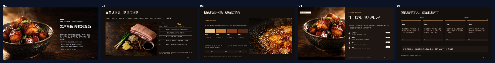
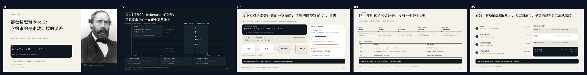

# PPT Assistant

English · [中文](README.md)

A DeepSeek Harness preset that turns a source document into a **fully editable PowerPoint** — argument first, mechanism diagrams when the content needs them, and an independent visual review before delivery.

[](https://www.npmjs.com/package/@yujp_vc/ppt-assistant)
[](LICENSE)
[](https://github.com/deepseek-ai/deepseek-harness)

## See it

<table>
<tr>
<td width="50%"></td>
<td width="50%"></td>
</tr>
<tr>
<td align="center"><b>Braised pork · showcase</b> · 5 pages<br><a href="assets/showcase/braised-pork.pdf">PDF</a></td>
<td align="center"><b>Riemann hypothesis · academic</b> · 5 pages<br><a href="assets/showcase/riemann.pdf">PDF</a></td>
</tr>
</table>

## What it does / doesn't do

| Does | Doesn't |
|---|---|
| Source docs/images → editable `.pptx` | A GUI deck editor or workbench |
| Writes a brief before choosing pages | Fixed page templates for every topic |
| Editable mechanism diagrams (nodes, edges, back edges) | Animations, transitions, SmartArt reproduction |
| Layout rhythm, text budget, font-size and source gates | Reverse-import any existing `.pptx` for in-place editing |
| Independent visual review; fixes reopen the build | Guaranteed design-agency quality on every page |
| Ships `spec.json` + `custom_builder.py` for rebuild | Invented research numbers or results |

## How it works

```text
source material
  → design brief (thesis / 3–5 claims / evidence / mechanism / audience / page count)
  → page plan (one claim per page; which pages need a custom builder)
  → spec + builder (native text, tables, shapes, connectors)
  → render (PPTX → PDF / page PNGs)
  → gates (rhythm / density / text budget / quality)
  → independent visual review (must-fix → rebuild → re-review)
  → deck.pptx / deck.pdf / spec.json / review_status.json
```

## Ask it like this

> Turn this report into a 5-page review deck. The images are product shots; you may generate scenes.

> Make it 8 pages, cool grey + deep blue, fewer cards, and the mechanism page must be readable.

> This page is too dense. Keep one conclusion and three pieces of evidence, then re-lay it out.

You do **not** need to specify `skeleton`, `mechanism`, or a page order. The preset writes the brief first and derives those.

## Quality gates

```bash
bash <engine-root>/run_py.sh rhythm_check.py spec.json
bash <engine-root>/run_py.sh density_check.py spec.json --strict
bash <engine-root>/run_py.sh text_budget_check.py deck.pptx spec.json
bash <engine-root>/run_py.sh quality_check.py deck.pptx
bash <engine-root>/run_py.sh review_gate.py output/
```

`review_gate` only accepts a signed independent review (`review-meta`); open must-fix items or no signature means the deck is still a draft.

## Install

```bash
dsh plugin --profile <profile> add @yujp_vc/ppt-assistant@latest
```

Replace `<profile>` with your DSH profile (`desktop` / `web`), restart DSH, then choose **PPT Assistant** when creating a session. See the Chinese README for the full step-by-step install.

## Compatibility

- DSH 0.2.1+ (verified on Linux Desktop 0.2.1-rc.3)
- Python 3.10+ with `python-pptx` and `Pillow`; `run_py.sh` finds the right interpreter
- LibreOffice + `pdftoppm` for rendering
- Tesseract for scanned OCR; `PEXELS_API_KEY` for optional web images
- Image generation is optional and uses your own key

## Limitations

- Stock layouts are for simple pages; mechanism pages need the custom builder
- Existing `.pptx` import/reverse editing is not the strong path
- Animations, transitions, SmartArt and high-fidelity chart preservation are out of scope
- Missing fonts and LibreOffice versions change rendering; always inspect the rendered pages
- AI image generation may time out; the build falls back to existing images or no image

## Security

- API keys stay in your `~/.config/ppt-assistant/image.json` or environment, never in this repo or the deck
- No telemetry; files stay local
- Only explicitly configured image/search calls leave the machine
